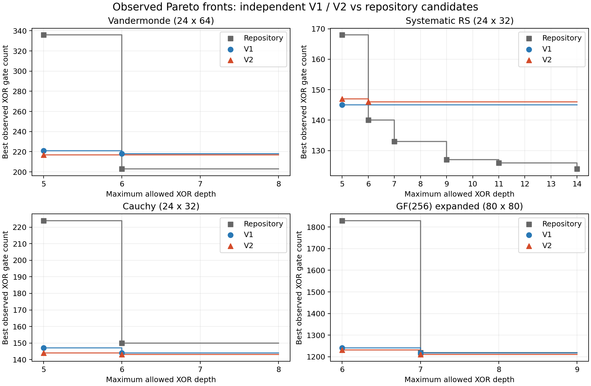

# 深度约束 XOR 线路优化：代码、方案与实验

本目录保存 OUR_DCCSE（旧版）和 OUR_DCCSE_V2（新版）的实现快照、方案说明、可逐门检查的线路证据及与 xordepth 的对比。原仓库根目录的程序和证据保持不变。

目标是在固定二进制矩阵 A、最大深度 D 下，生成 y=Ax（GF(2)）的 XOR2 网络，尽可能减少存活 XOR 门数。所有结果均为启发式可实现上界，不是全局最优性证明。

## 导航

- [方案说明](METHOD.md)：深度可行共享提取、有限前瞻、联合改写与边界。
- [实验设置与结论](EXPERIMENTS.md)：相同矩阵、预算、Pareto 前沿和负结果。
- [代码快照](code/src/depth_cse.cpp)：旧版、新版共享的实现与局部改写接口。
- [原生 CLI 快照](code/apps/ringlab.cpp)、[核心测试](code/tests/depth_cse_test.cpp)。
- [集成补丁](integration.patch)：针对实验基准版本的完整补丁，不应直接覆盖已经更新的根目录程序。
- [完整 Pareto 报告](artifacts/pareto_extension/report.html)、[全部候选 CSV](artifacts/pareto_extension/all_candidates.csv)、[前沿 JSON](artifacts/pareto_extension/summary.json)。
- [V2 对照结果](artifacts/v2_results/comparison.csv)、[大规模结果](artifacts/large_scale/summary.json)、[早期谱图探索](artifacts/early_graph/graph_fixed_summary.json)。

## 构建和验证

实验源码基准是 `4b6a4e83b00c2cd66cfd9798e41959ca0361a25a`。整理本目录时观察到的远程 main 为 `6fa526db4647d93570d41d9355c01a02e9c40e45`；已有实验没有在这个更新版本上重新运行。为保证可复现，构建脚本导出固定版本，在独立目录应用补丁，不改动当前根目录代码。

```sh
bash experiments/depth_xor_optimization/scripts/build_and_test.sh
```

脚本会打印独立构建目录。其内可以运行：

```sh
./build/ringlab analyze xordepth/data/matrices/cauchy_7_4_direct.txt \
  --method OUR_DCCSE_V2 --depth 5 --seeds 8 --seed 1 --output /tmp/v2.json
./build/ringlab verify --input /tmp/v2.json --samples 0
```

`--seeds 8` 在 V2 中表示两种策略各8次，共16次。旧版对照使用 `--method OUR_DCCSE --seeds 16`。独立合成不使用 `--incumbent`；加载历史线路的结果单独标注，不能混为独立合成。

已有 `make test`、`xordepth make test` 和 ASan/UBSan 检查日志保存在 `artifacts/v2_results/`。ASan 检查关闭了 leak sanitizer，不代表完成泄漏检查。CMake源列表保持同步，但当时环境没有CMake，未声称完成CTest。

## 当前观察前沿

格式为（XOR门数，实际最大深度）；仓库一列汇总对应固定矩阵的已有证据，不代表统一时间预算下重跑所有算法。

| 矩阵 | 仓库已有候选 | 旧版独立合成 | 新版独立合成 |
|---|---|---|---|
| Vandermonde 24×64 | (336,5)、(203,6) | (221,5)、(218,6) | (217,5) |
| 系统化RS 24×32 | (168,5)、(140,6)、(133,7)、(127,9)、(126,11)、(124,14) | (145,5) | (147,5)、(146,6) |
| Cauchy 24×32 | (224,5)、(150,6) | (147,5)、(144,6) | (144,5)、(143,6) |
| GF(2⁸)展开80×80 | (1830,6)、(1219,7) | (1241,6)、(1217,7) | (1231,6)、(1210,7) |



更深的上限在本轮固定策略/种子下没有产生新的独立合成前沿点。RS是目前弱项；新版不能全面替代旧版或仓库已有方案。完整证据保留成功、超时、探索性实验和各次运行参数。

## 复现实验与目录约定

`artifacts/` 保留会话中的实验目录结构和原始数据；部分历史脚本仍含当时的工作区路径，仅作为原命令记录。当前四矩阵新脚本使用 `REPO_ROOT` 指定上面的独立构建目录；审计脚本只读取结果，不实现线路合成。先阅读各实验自己的README。`artifacts/pareto_extension/analyze.py` 可在目录内使用打包的 `reused_evidence` 独立重算前沿。

`MANIFEST.sha256` 记录本目录文件校验和，避免误改历史线路证据。没有提交二进制优化器、构建缓存、凭据或外部依赖安装目录。
